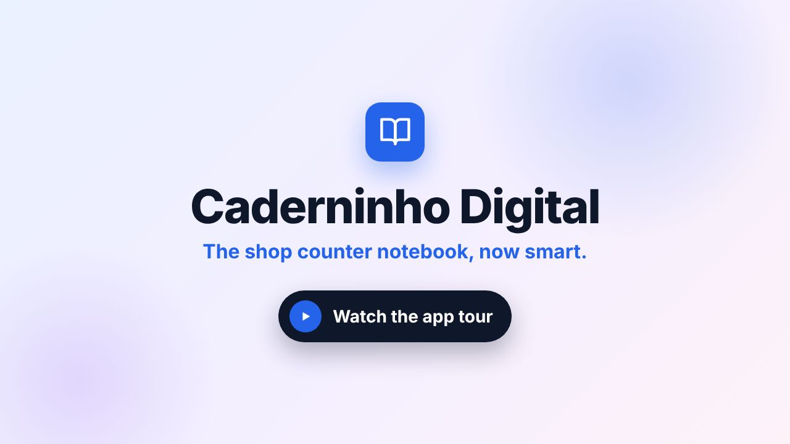
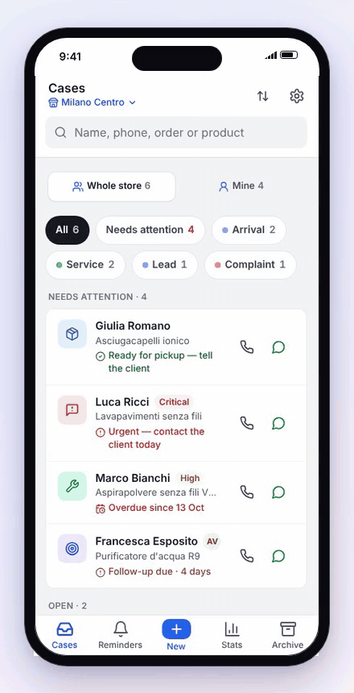
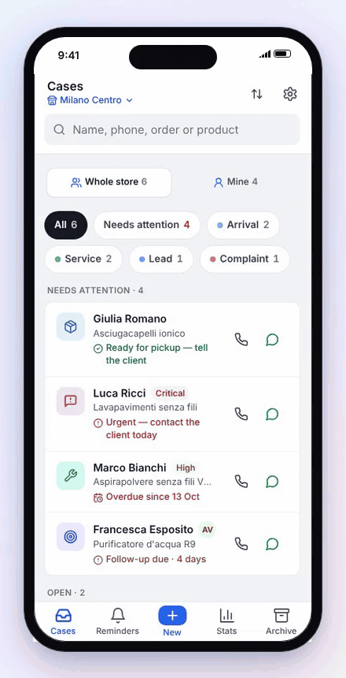
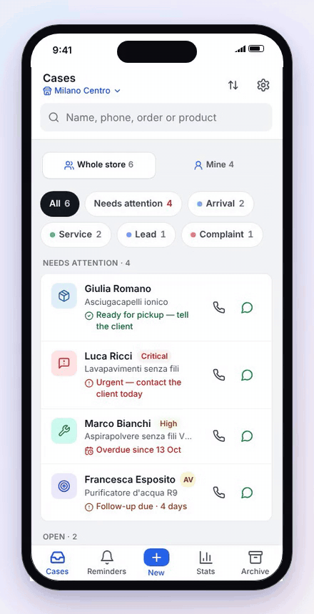
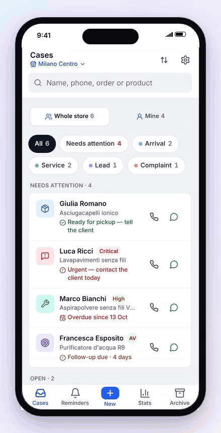
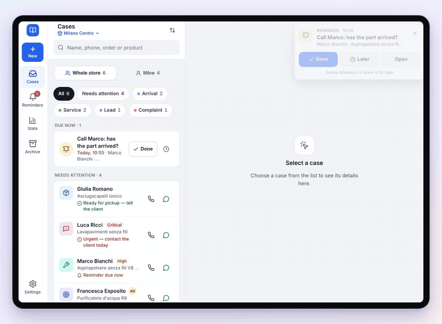
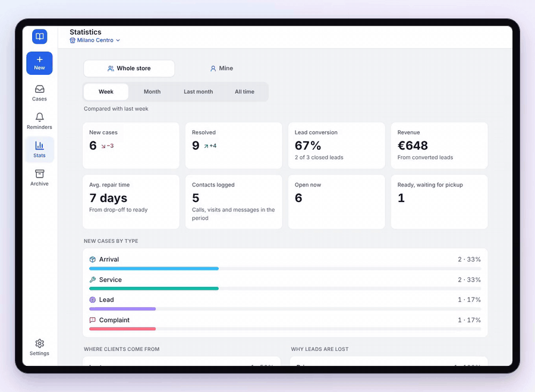
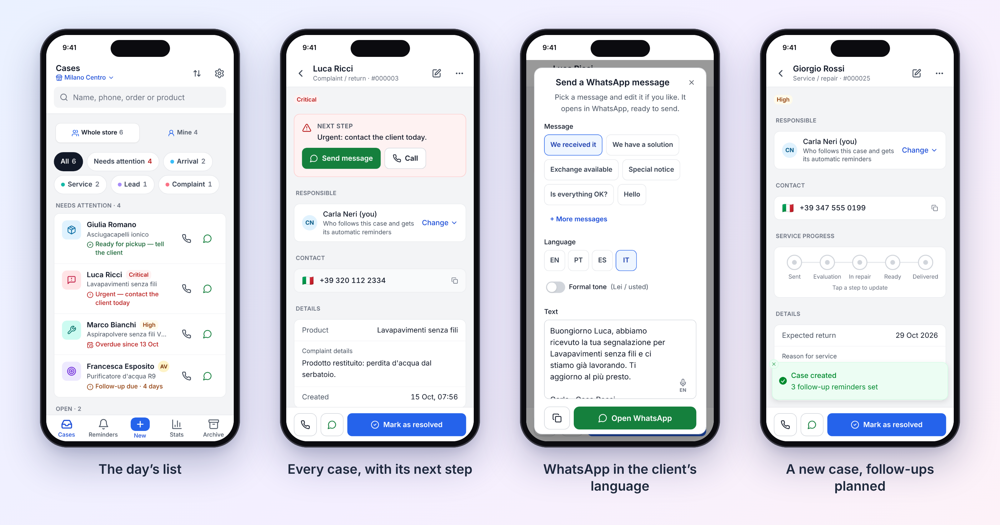
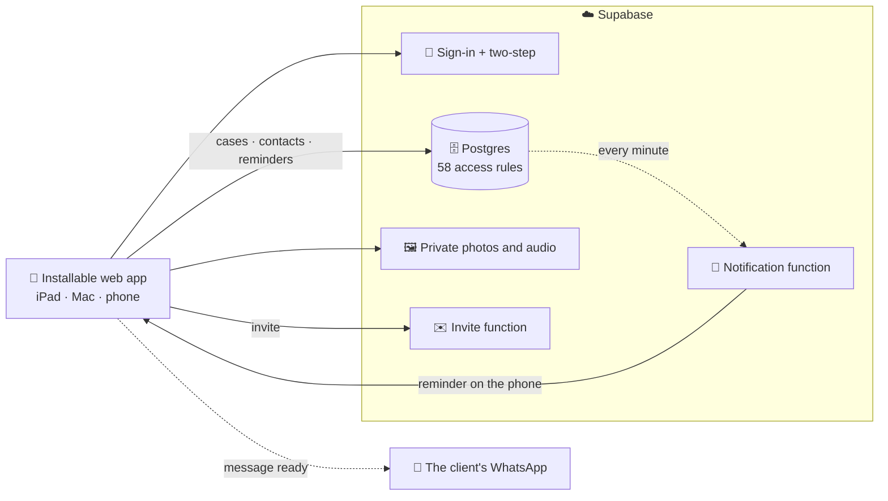

  
  
  
  
  

**[See it in action](#in-30-seconds)** · **[How it works](#how-it-works)** · **[Inside](#inside)** · **[Website](#website)**

**Caderninho Digital is a CRM for the counter of shops that repair, order and follow up**: appliances, electronics, phones, optics, bikes. Every customer waiting on a part, a repair, an answer about a purchase or the fix for a complaint becomes a **case**. The app shows what to do next, reminds the team at the right moment and has the WhatsApp message ready, in the client's language.

It runs on the **iPad** at the counter, on the shop's Mac and on phones. One company can have **several stores** and a **team** with roles. Shops pay a monthly subscription per store.

  
   <b>The tour in 50 seconds</b> — click the image to watch.

---

## In 30 seconds

<table>
  <tr>
    <td width="50%" align="center" valign="top">
      
       <b>It tells you what to do now</b>
       What needs you comes first. Each case shows its next step and a message in the client's language.
    </td>
    <td width="50%" align="center" valign="top">
      
       <b>A new case in seconds</b>
       Type, a ready-made template, name and phone. The follow-ups are planned for you.
    </td>
  </tr>
  <tr>
    <td width="50%" align="center" valign="top">
      
       <b>Swipe to close a case</b>
       Right to resolve, left to delete. Everything can be undone.
    </td>
    <td width="50%" align="center" valign="top">
      
       <b>Four languages</b>
       Each person uses the app in theirs; clients get messages in their own.
    </td>
  </tr>
</table>

  
   <b>Reminders that don't slip</b> — done, later or open the case; list and case side by side on the iPad.

  
   <b>The shop in numbers</b> — conversion, sales, repair time and where clients come from, per store or per person.

---

## How it works

### What shops get

- **Four kinds of case**: special orders, repairs, sales leads and complaints. Each shop can rename them and the repair stages with its own words.
- **"Needs attention" first**, with the reason: urgent and not contacted today, ready for pickup but the client not told, return overdue, complaint waiting, follow-up due. The case screen gives the same next step, with a button.
- **Reminders**: one tap for tomorrow, 3 days or a week. Automatic follow-up plans per case type, and an after-sale check-in 7 days after closing. Alerts on screen, as push notifications when the app is closed.
- **WhatsApp messages for every step**: arrived, sent for repair, ready for pickup, follow-up, "is everything OK?", exchange available. They are written in the client's language (IT/PT/ES/EN), formal or informal, signed by the sender and logged as a contact.
- **Closing the loop**: leads won with the sale value or lost with the reason, repairs delivered, orders picked up. Everything has Undo.
- **Teams**: company → stores → people, with owner, manager and consultant roles. One-time invite links, a person responsible for each case, and open cases handed over when someone leaves.
- **Stats** by period with comparisons, and an archive with search and an Excel-ready export. Photos, voice notes and dictation.
- **Private by design**: sign-in by invitation, optional two-step login, each company's data kept apart by the database itself. The app stores no addresses and no payment details.

---

## Inside

### How it is built

| Layer | Technology |
|---|---|
| App | React 18, TypeScript, Vite, Tailwind CSS, Radix UI, TanStack Query, React Hook Form + Zod |
| Backend | Supabase: Postgres with row-level security, auth with TOTP, storage, Edge Functions (Deno) |
| Notifications | Web Push (VAPID) on a schedule (`pg_cron`) |
| Quality | Vitest (156 unit tests), a real Postgres for the access rules (113 checks), Playwright in the browser (19 suites, 280 checks), CI on every change |
| Media | Recorded from the app with Playwright + ffmpeg, the tour assembled with Remotion |

There is no app server: **who can see what is decided by the database**. That covers company and store isolation, roles, invites and hand-overs, and every rule is tested against a real Postgres. Big stores stay fast because the access check runs once per request instead of once per row (store list 243 ms → 1.3 ms with 70,000 cases).

The app's source code is private. This repository holds the public website and this page.

---

## Website

This repository is also the product's website (`index.html`, plain HTML/CSS/JS, no cookies or tracking). See [DEPLOY.md](DEPLOY.md) to publish it.

© Caderninho Digital. All rights reserved.
